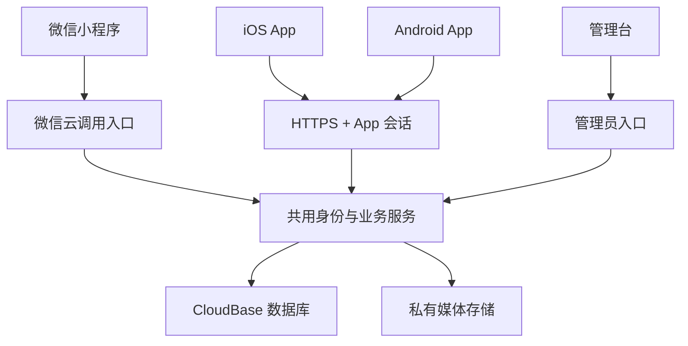

# Ours 小程序、iOS 与 Android 规划

日期：2026-10-13

状态：设计方案，尚未实施。本文不代表已创建 App、部署接口、迁移数据或变更云套餐。

前提：保留现有微信小程序，未来增加 iOS 和 Android；沿用双人私密空间，也兼容当前邀请码和配额管理。

## 1. 推荐决策

保留原生微信小程序。新增 React Native + Expo + TypeScript App，让 iOS 和 Android 共用主要界面与客户端逻辑。初期继续使用现有 CloudBase 环境，增加经过身份验证的 HTTPS 接口，并让微信入口、App 入口和管理后台共用业务服务。

App 使用本地 SQLite 和媒体缓存，云端保存双人共享记录及共享媒体。GitHub 保存源码、构建配置与安装包，私人记录和媒体不放进代码仓库。

先解决三端共同身份、接口和同步，再决定是否迁移云服务。当前额度够用，不能仅凭存储单价判断迁移能否降低总成本。19.9 元套餐的年支出为 238.8 元；取消它的最大基础套餐节省也是这个量级，新后端、域名、备份和维护仍有成本。

这与此前“为了最低月费先迁 uniCloud”的讨论侧重点不同：在三端规划中，交付成本、媒体兼容和数据连续性优先于立即迁云。uniCloud 阿里云按量计费保留为后续降本候选，并非排除。

## 2. 现有代码依据

| 现有位置 | 已有能力 | 对规划的影响 |
| --- | --- | --- |
| `miniprogram/services/cloud-api.ts` | 统一 `callOurs`，按操作决定重试 | 保留小程序请求入口，避免全量改页面 |
| `miniprogram/services/types.ts` | 双人空间、回忆、评论、实况等类型 | 提取不依赖 `wx` 的共享接口类型 |
| `cloudfunctions/ours/index.js` | 使用 `cloud.getWXContext().OPENID` 鉴权 | App 的 HTTPS 请求必须另行验证身份 |
| `cloudfunctions/ours/index.js` | 成员和作者以 `openid` 标识 | 引入内部用户 ID，兼容历史身份 |
| `cloudfunctions/ours/index.js` | 云数据库事务、发布去重、删除补偿 | 复用这些业务规则，避免复制另一套后端 |
| `miniprogram/services/store.ts` | `wx.cloud.uploadFile`、媒体处理 | App 另建上传适配，统一媒体标识 |
| `cloudfunctions/ours/index.js` | `startBackup` / `exportBackupPart` | 已有导出能力，但恢复流程仍需设计和验证 |
| `admin-web/` | React + TypeScript 管理台 | 继续保留独立管理界面 |

以上为读取当前仓库的结果，不代表已检查线上部署、数据库权限或真实账单。

## 3. 产品分工与技术选择

| 端 | 产品定位 | 技术选择 |
| --- | --- | --- |
| 微信小程序 | 邀请、轻量记录、快速查看、现有用户入口 | 保留 WXML / WXSS / TypeScript |
| iOS App | 日常记录、离线回忆、相册和实况体验 | React Native + Expo + TypeScript |
| Android App | 与 iOS 共用核心功能，适配相册及设备差异 | 同一个 App 工程 |
| 管理台 | 邀请码、空间状态、额度、用量管理 | 保留 React + Vite |
| 后端 | 身份、空间权限、共享记录、媒体授权、同步 | 复用现有 Node.js 业务，初期运行于 CloudBase |

选择 React Native / Expo 的理由是与现有 TypeScript、React 技术栈衔接，且官方提供 iOS / Android 原生构建、本地数据库和媒体模块。[S1][S2][S3]

这里共享的是 App 主代码、接口类型和纯业务工具，WXML 页面不能直接变成 React Native 页面，`wx.*` 也不能直接在 App 调用。平台相关模块通过少量适配实现。

Flutter 是可行替代，但需要额外维护 Dart。为统一三个前端而现在重写小程序，会扩大改动面。根据当前仓库，推荐保留现有小程序并只共享适合共享的逻辑，不追求所有页面一份代码。

App 沿用“首页 / 回忆 / 我们”三个主导航，发布作为主操作入口。优先保持用户对现有产品的理解，再按原生设备优化相册、播放、缓存和通知。

## 4. 后端结构

CloudBase 官方支持通过 HTTP / HTTPS 接入云函数等资源，移动 App 并不必然要求迁走现有数据库。[S4]

实现上先从 `ours` 提取共同业务模块，再分别构建微信和 App 入口。同一份源码服务两个入口，不能把整份业务文件复制后各自修改。管理台保留独立管理员权限，调用相同的数据规则。

App 入口验证会话后得到内部用户 ID，再执行空间成员、作者权限、配额和内容校验。不能通过接受客户端传入的 `openid`、`userId` 或 `coupleId` 来证明身份。

HTTP 入口只是接入方式，访问控制必须在服务端落实。按 CloudBase 当前生产接入建议，使用已完成备案的自有 HTTPS API 域名，保持接口地址稳定，并完成证书和网关配置。[S4]

第一阶段必须在当前环境验证：现有套餐能否满足所需 HTTP 路由、会话和直传能力；是否需要调整计费模式；会不会引入额外固定费用。若必须升级到明显更贵的套餐，就提前评估迁移，不为新增 App 自动购买高配套餐。

## 5. 三端共同身份

目标是“同一个人、同一个空间、同一批回忆”，而不是每端创建独立账号。

建议新增 `users`、`identities`、`app_sessions`，保留原有 `couples` 和记录 ID：

- `users.id` 是内部 `userId`。
- 微信身份记录包含 provider、对应 AppID 和服务端验证得到的 subject，映射到 `userId`。
- `couples.memberA/memberB` 增加 `userId`；迁移期间兼容原有 `openid`。
- 作者字段逐步补充 `authorUserId`，通过适配读取历史 `authorOpenid`。
- 微信身份、App 登录凭据和将来的其他登录方式都绑定内部用户，不直接充当跨端业务主键。

第一版 App 用已有小程序确认关联：

1. App 创建短时设备绑定请求。
2. 已登录的小程序用户确认绑定到自己已有的成员身份。
3. 服务端验证请求有效期、使用次数和设备请求凭据，创建 App 会话。
4. App 获得短期访问令牌和可轮换的刷新令牌。

绑定请求需要短期有效、单次使用、限制尝试次数，并向确认者显示待绑定设备。不能凭昵称、手机号相似或某个空间 ID 自动合并账号。

第一版优先保留现有用户迁移路径。公开给新用户之前，补充独立账号创建、恢复和账号解绑；让微信确认不再成为唯一恢复方式。登录凭据使用系统安全存储，用户可以撤销丢失设备的会话。

## 6. 本地与云端的数据职责

| 内容 | App 本地职责 | 云端职责 |
| --- | --- | --- |
| 草稿和未发布媒体 | 原始文件、编辑内容、待提交任务，持久保存 | 成功发布前不当成共享回忆 |
| 已发布文字和记录 | SQLite 副本、离线搜索、同步状态 | 共享版本、权限、增量同步 |
| 缩略图 | 有上限的可清理缓存 | 保存可重新下载的缩略图 |
| 已同步照片 / 视频 / 语音 | 缓存，或用户主动保留的离线副本 | 保存用于共享和换机恢复的媒体 |
| 本地待上传媒体 | 不进入可清理缓存 | 上传成功、核验和提交后确认状态 |
| 导出的备份 | 保存到用户选择的位置 | 提供导出记录，不依赖临时链接做长期恢复 |

Expo SQLite 支持 iOS 和 Android 的持久数据库，适合作为 App 本地记录与同步队列的基础。[S2]

“本地优先”的收益是离线体验、减少重复下载和更快启动，不自动减少云端共享容量。保留小程序和两人远程查看，就需要一个双方能访问的媒体副本。

不以用户手机是否在线作为共享媒体可用的条件，不在某台手机下载成功后立即删除云端原件，也不把 iCloud 作为三端共同主库。

## 7. 同步协议

第一版实现有界的增量同步，无需引入复杂协同编辑算法：

- 记录使用稳定 ID 和服务端版本，发布任务使用固定 `requestId` / `operationId`。
- 离线任务持久化到本地队列；重启后继续，不因超时重新生成发布编号。
- 创建、编辑、删除、目标点赞状态分别定义幂等行为；失败提示和重试可追踪。
- 服务端按空间分配变化序号；客户端以游标读取变化，不用设备时间判断先后。
- 编辑提交携带基础版本，冲突时保留用户输入并要求选择，不静默覆盖。
- 删除保留同步标记。过期游标要求重新获取快照；对已删除记录的旧编辑不能当作创建。
- 离线打卡保留原记录时间，是否计入当天和连续天数由服务端统一规则决定。
- 首次进入获取快照，之后在启动、回到前台、联网恢复和用户刷新时追赶变化。

手机后台执行由系统调度，不能承诺退出 App 后持续实时同步。[S5] 远程通知只作为提醒，实际数据仍通过同步接口读取。

建议初版接口覆盖会话、空间、回忆、评论、点赞、纪念日、打卡、媒体上传票据、媒体确认、增量变化和备份。先保证现有操作的契约，再调整路由风格，不为了 REST 命名重写所有小程序调用。

## 8. 媒体设计和成本控制

对外使用独立 `mediaId`，服务端映射 storage provider、对象位置、空间、上传者、真实大小、类型和状态。旧 `cloud://` 文件先由适配器解析，不强制一次性迁移。

媒体上传流程：

1. 服务端校验身份、空间状态和可用额度，签发限定文件的短时上传凭据。
2. App / 小程序直接上传存储服务，避免把大视频经业务云函数中转。
3. 服务端核验对象归属、存在性和真实大小。
4. 提交回忆与媒体引用；未完成上传和未被引用对象进入延迟清理。

直传的 SDK / HTTP 接入必须在原型阶段验证，不能把永久云密钥放进安装包。短时访问 URL 不作为媒体主键，过期后重新授权。

建议策略：

- 时间轴只加载缩略图，不批量拉取原视频。
- 默认生成适合移动屏幕的图片展示版本；原图保存为可配置选项，清楚说明导出是否包含原图。
- 普通视频在端上压缩；优先先验证现有规格和主流设备效果，避免第一版依赖云转码。
- 本地缓存设置容量上限，用户可清理已同步缓存和指定离线保留内容。
- 配额按空间计算，并展示用量；上传前后都由服务端核验。
- 视频上传先保障前台任务持久状态和恢复；不能在验证前承诺跨后台持续上传或字节级断点续传。

实况单独处理：Expo 有 iOS Live Photo 显示模块，但照片和配对视频必须保持有效元数据。[S6] 新的 iOS 原始实况需要保留配对；安卓和小程序用封面加短视频播放。已有小程序“封面 + 视频”不保证能恢复为苹果原生 Live Photo，不能批量压缩后假定配对仍有效。

原始实况和普通展示版本分开计量。原件保存会增加成本，需要结合用户价值决定，不能一边承诺原件可恢复，一边为节省容量删除必要配对信息。

## 9. App 首版范围

### 内测必须具备

- 关联已有空间和设备会话。
- 首页、回忆时间轴、详情、搜索。
- 照片发布、文字发布、普通视频和语音的基本读写。
- 持久草稿、离线查看、离线发布队列、明确同步状态。
- 评论、目标点赞状态、纪念日和打卡。
- 存储用量、缓存清理、导出及恢复演练。
- Android 和 iOS 的基本相册、录音及文件权限体验。

### 专门验证后交付

- 原生 iOS 实况选取、保存和跨设备播放。
- 长视频、弱网、磁盘不足、前后台切换后的任务恢复。
- 地图和地点的跨端坐标及供应商一致性。

### 后续增强

- 系统小组件、分享入口、较大范围的媒体批处理。
- 远程通知的 iOS / Android 通道及到达率优化。
- 收费套餐和完整支付流程；跨端使用同一权益记录。

第一版提醒优先用本地纪念日通知。远程小纸条提醒随后接入 iOS APNs 和适合目标安卓设备的推送通道，不以持续轮询换取后台提醒。

对于私密产品，管理台默认只显示状态、额度和汇总信息；私人内容访问应收敛权限，并记录授权和审计。端到端加密是独立设计项目，需要同时解决三端密钥和恢复，不在第一版宣传尚未实现的能力。

## 10. GitHub、安装和更新

源码和构建配置留在一个仓库。未来新增 `mobile/`，共享接口和业务工具放在小范围的 `packages/`；现有 `miniprogram/`、`cloudfunctions/`、`admin-web/` 继续保留。目录调整只在实际需要复用时实施。

开发和内测先用本机 Xcode / Android 工具链，Expo 支持本地构建签名发行版本，不必须购买 EAS 云构建套餐。[S3]

稳定后增加 GitHub Actions：

- 普通提交运行必要检查，不每次都构建双端发行包。
- 版本标签或手动发布任务生成 APK / IPA。
- Android 维持同一 package name 和签名密钥，验证覆盖升级。
- iOS 维持同一 Bundle ID、签名团队和对应的分发方式。
- 证书放在受保护的构建凭据中，限制可读取凭据的工作流；构建产物不包含私有记录或服务端密钥。
- 私有仓库的托管 Actions 存在免费额度及超额收费，macOS 构建纳入预算。[S7][S8]

Android 内测可分发签名 APK。长期面向用户时需核对目标地域和设备的分发要求；截至本文日期，Android 开发者验证已于 2026-09-30 在指定国家的参与商店开始实施，官方计划 2027 年扩大范围，不能把 GitHub APK 当成永久不变的分发条件。[S9]

iOS 第一轮原型可用免费个人团队真机测试，但描述文件 7 天到期。[S10] 固定设备内测可以用付费账号 Ad Hoc；朋友和更多测试者可用 TestFlight，每个构建有效期最多 90 天。TestFlight 属于测试分发，不是无限期正式发行。[S11][S12]

Apple Developer Program 官方基础价格为 99 美元/会员年，地区价格以注册时显示为准。[S13] GitHub 自动构建不消除苹果签名、设备或测试期限要求。

GitHub 是代码和构建分发工具。面向大陆普通用户的正式下载和更新入口，还需实测国内可达性；发布包可以在同一签名规则下增加国内可达的下载镜像，更新检查走自己的 API。

## 11. 费用和迁云决策

| 项目 | 第一阶段 | 后续决策 |
| --- | --- | --- |
| 后端 | 保留当前 19.9 元套餐，三端复用环境 | 新请求增加用量，超额费用另计 |
| API 域名 | 使用自有域名，按真实注册与续费价格核算 | 保持客户端入口稳定 |
| App 构建 | 本机优先，发布版本才跑 CI | 监控 Actions 的分钟及产物费用 |
| iOS 分发 | 原型免费测试，长期内测另列开发者账号预算 | 账号费用和后端费用分别计算 |
| 备份、通知、地图 | 按实际功能使用和供应商计费核算 | 不把所有相关成本归到“存储” |

CloudBase 当前个人版资源点价格为 19.9 元/月、40,000 点。资源共享分配有利于容量需求，但不能据此承诺消除固定月费。[S14] 本方案不立即变更套餐。

uniCloud 阿里云按量收费保留为降本候选，官方媒体存储为 0.0043 元/GB/天、CDN 下载为 0.18 元/GB；自 2026-03-16 起，每个发生消耗的函数、每个活跃小时资源费最低 0.01 元。[S15]

以 10GB 存储 + 每月 5GB 下载计算，30 天的两项费用为 2.19 元，尚未包含函数、数据库等。若一个函数每小时都有运行，30 天的函数资源最低费为 7.2 元；三个这样持续活跃的函数为 21.6 元。这些是假设测算，不是当前应用账单。

迁移门槛采用以下规划条件，而不是只比较一张价格表：

1. 在真实的 App + 小程序使用形态下，连续测算至少两个周期，包含函数最低消费、流量、备份、域名和迁移期间双跑费用。
2. 新后端能通过同样的身份、事务、配额、幂等、私有媒体和恢复验证。
3. 迁移后预计总支出与维护负担确实更合适；如果只省几元而显著增加维护，就继续保留现有后端。
4. 媒体占成本大头时，先评估仅迁媒体；需要取消固定月费时，才评估迁走整个 CloudBase 依赖。

迁移通过稳定 API 和媒体映射完成：复制并校验数据、保持空间与用户 ID、用测试端验证、短时控制写入完成切换、保留回退窗口。避免没有一致性方案的长期双写。关闭旧环境前必须验证全量导出、媒体校验和恢复。

## 12. 阶段与验收

| 阶段 | 交付 | 必须通过的验收 |
| --- | --- | --- |
| A：三端基础原型 | 内部用户、App 会话、共用业务模块、HTTPS 接口和媒体直传原型 | 同一成员跨端访问同一条回忆；伪造身份和跨空间访问被拒绝；确认套餐和域名条件 |
| B：App 核心内测 | 共用 App 工程、SQLite、草稿、回忆读写、同步队列 | 离线发布重启不丢；重试不重复；三端编辑和删除最终一致 |
| C：媒体与恢复 | 图片/视频/语音、实况兼容、缓存、导出恢复 | iOS 和安卓真机、历史媒体、弱网、存储不足、权限拒绝、换机恢复 |
| D：发行与降本 | 签名升级、GitHub 构建、版本检查、真实费用评估 | 更新保留本地数据；目标设备能安装；验证签名到期流程；凭据不进入安装包 |

Android 核心流程先形成完整可安装版本，同时尽早在 iPhone 真机验证签名和实况，不把 iOS 平台风险留到所有页面完成后。

不承诺在所有手机后台永久在线。对通知及时性、上传恢复、实况配对和备份完整性分别验证，任何一个未通过就如实缩小首版承诺。

当前最值得实施的下一项是阶段 A 的最小原型，而不是先迁数据库、先重新做全部页面，或先购买更大套餐。

## 13. 官方资料

以下资料于 2026-10-13 核对。价格与分发条件实施时应再次确认，本文不绑定尚未验证的 SDK 最新版本。

- [S1] Expo 项目与 iOS / Android 支持：https://docs.expo.dev/get-started/create-a-project/
- [S2] Expo SQLite 持久数据库：https://docs.expo.dev/versions/latest/sdk/sqlite/
- [S3] Expo 本地发行构建：https://docs.expo.dev/guides/local-app-production/
- [S4] CloudBase HTTP 访问与生产域名：https://docs.cloudbase.net/service/access-cloud-function
- [S5] Expo 后台任务及系统限制：https://docs.expo.dev/versions/latest/sdk/background-task/
- [S6] Expo LivePhoto 支持及配对元数据限制：https://docs.expo.dev/versions/latest/sdk/live-photo/
- [S7] GitHub Actions 安装苹果签名证书：https://docs.github.com/en/actions/how-tos/deploy/deploy-to-third-party-platforms/sign-xcode-applications
- [S8] GitHub Actions 计费：https://docs.github.com/en/billing/concepts/product-billing/github-actions
- [S9] Android 开发者验证：https://developer.android.com/developer-verification
- [S10] Apple 免费个人团队与 7 天限制：https://developer.apple.com/help/account/basics/about-your-developer-account
- [S11] Apple Ad Hoc：https://developer.apple.com/help/account/provisioning-profiles/create-an-ad-hoc-provisioning-profile/
- [S12] TestFlight 分发：https://developer.apple.com/help/app-store-connect/test-a-beta-version/testflight-overview/
- [S13] Apple Developer Program 会员费用：https://developer.apple.com/programs/enroll/
- [S14] CloudBase 资源点计费：https://cloud.tencent.com/document/product/876/127357
- [S15] uniCloud 阿里云价格及最低消费：https://doc.dcloud.net.cn/uniCloud/price
